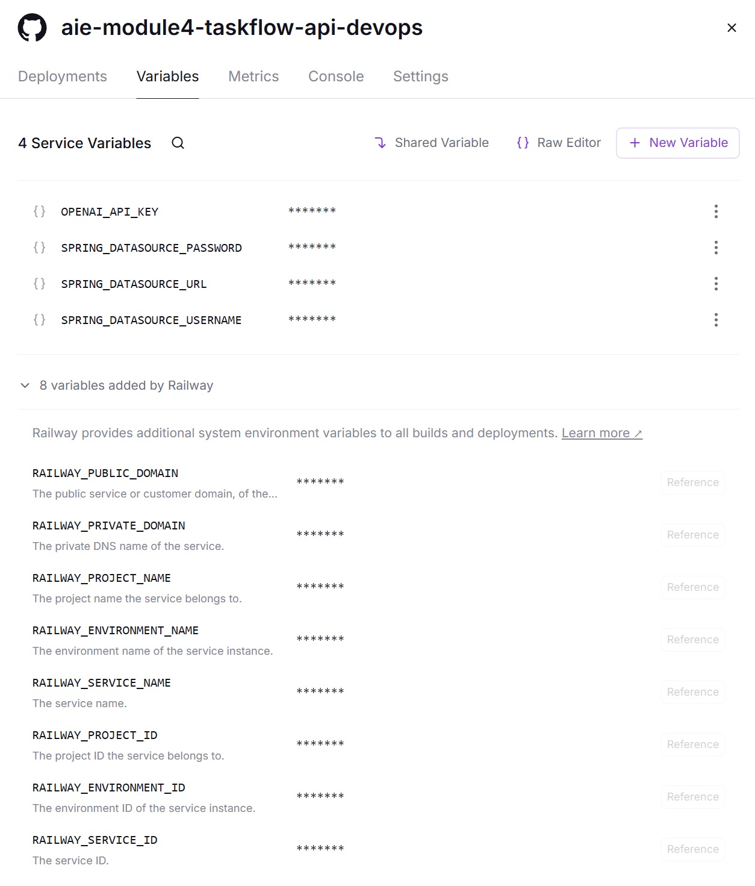
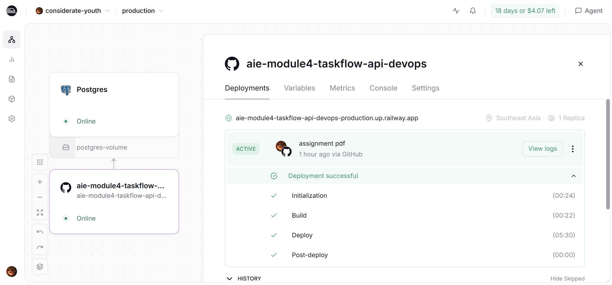
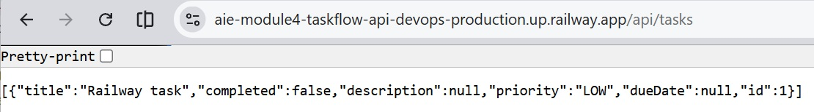
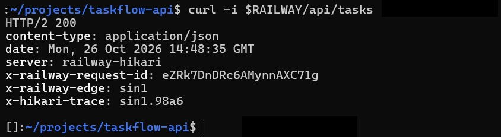
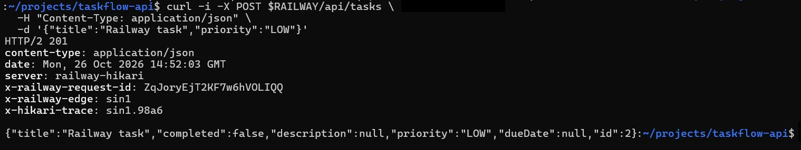
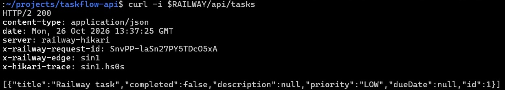
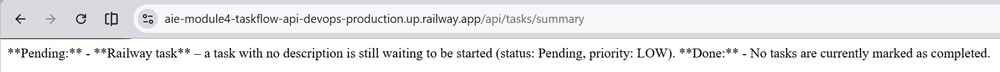

# TaskFlow API

A Spring Boot task management backend API with CRUD operations and AI-powered task summarization.

## Module 4: Docker & Railway Deployment

**Live application URL:** https://aie-module4-taskflow-api-devops-production.up.railway.app/api/tasks

### Dockerfile

The `Dockerfile` is a multi-stage build. Stage 1 builds the JAR with Maven, and stage 2 copies only the JAR into a slim JRE image. Railway builds the image from the GitHub repo, so no local build is needed.

This Dockerfile differs from the assignment template. It copies `pom.xml` and runs `mvn dependency:go-offline` before copying `src/`, so rebuilds reuse the dependency cache. The two stages and the final `CMD` are the same as the template.

### Build and run the Docker image locally

```bash
# Build the image
docker build -t taskflow:latest .

# Run the app and PostgreSQL together (PostgreSQL data is kept in the taskflow-db-data volume)
docker compose up -d --build

# In a second terminal, test the application
curl http://localhost:8080/api/tasks

# Stop the containers (add -v to also delete the database volume)
docker compose down
```

Compose wires the app to its PostgreSQL container, so no local database setup is needed. The local PostgreSQL server is not used by this run. Compose publishes PostgreSQL on host port `5432`, so stop the local server first (`sudo service postgresql stop`) or the database container will fail to start.

`OPENAI_API_KEY` is read from your shell environment, not stored in the repo.

### Railway setup

1. **Create the app service.** In the Railway project, click **New → GitHub Repo** and select the TaskFlow repository. Railway builds the root `Dockerfile` automatically.
2. **Create the database.** In the same project, click **New → Database → PostgreSQL**. Railway creates a service named `Postgres` with its own connection variables.
3. **Connect the app to the database.** Open the app service, go to **Variables**, and add these. The `${{Postgres.…}}` values are Railway reference variables, so the password is never typed out or committed:

   | Variable | Value |
   | --- | --- |
   | `SPRING_DATASOURCE_URL` | `jdbc:postgresql://${{Postgres.PGHOST}}:${{Postgres.PGPORT}}/${{Postgres.PGDATABASE}}` |
   | `SPRING_DATASOURCE_USERNAME` | `${{Postgres.PGUSER}}` |
   | `SPRING_DATASOURCE_PASSWORD` | `${{Postgres.PGPASSWORD}}` |



4. **Add the AI key for the summary endpoint.** The app calls OpenRouter (`spring.ai.openai.base-url=https://openrouter.ai/api/v1`), so create a key at openrouter.ai/keys and add it as `OPENAI_API_KEY` in the same Variables tab. Do not commit it or put it in the Dockerfile.
5. **Deploy and expose the app.** Railway redeploys when variables change. Check the deploy logs for `Started TaskflowApiApplication`. Then go to **Settings → Networking**, click **Generate Domain**, and set the port to `8080`.

The app's `application.properties` reads these variables, and it defaults to `localhost:5432` if they're unset. Railway's dashboard is the source of truth for the exact service name and variable names, so check them there if a reference doesn't resolve.

### Screenshots





### Deployment Verification

Tests run against the live Railway URL, in this order:

* check the initial state
* create a task
* list tasks again
* request the AI summary

```bash
RAILWAY=https://aie-module4-taskflow-api-devops-production.up.railway.app
```


On a fresh database, step 1 returns `[]`.

```bash
# 1. Initial state: the database starts empty
curl -i $RAILWAY/api/tasks
# HTTP/2 200
# []
```



```bash
# 2. Create a task
curl -i -X POST $RAILWAY/api/tasks \
  -H "Content-Type: application/json" \
  -d '{"title":"Railway task","priority":"LOW"}'
# HTTP/2 201
# {"title":"Railway task","completed":false,"description":null,"priority":"LOW","dueDate":null,"id":1}
```



```bash
# 3. List tasks again: the new task is returned
curl -i $RAILWAY/api/tasks
# HTTP/2 200
# [{"title":"Railway task","completed":false,"description":null,"priority":"LOW","dueDate":null,"id":1}]
```



```bash
# 4. AI summary (uses OPENAI_API_KEY from Railway Variables)
curl -i $RAILWAY/api/tasks/summary
# HTTP/2 200
# Here's a quick summary:
# - **Pending:** There's one task in the list called "Railway task." ...
```



### Errors and failures

- **`docker build -t taskflow:latest .`** completed successfully.
- **`docker run -p 8080:8080 taskflow:latest`** started the app, but it exited during startup with:
  - `Connection to localhost:5432 refused`
  - `Failed to initialize JPA EntityManagerFactory: Unable to determine Dialect without JDBC metadata`

The app needs a reachable PostgreSQL server at startup, and it fails immediately if it can't connect. Two causes gave the same `Connection to localhost:5432 refused` error:

- **Container networking:** `docker run` gave the container its own `localhost`, where no PostgreSQL runs, so the container couldn't reach the local server. Workaround: `docker compose up -d --build`, which starts PostgreSQL alongside the app.
- **Local server stopped:** on this machine PostgreSQL doesn't autostart, so it has to be started with `sudo service postgresql start` before any run that uses it.

The Railway deployment is unaffected because it uses its own database.

### Database

The app uses PostgreSQL rather than the in-memory H2 database from the Module 3 guide. This was what I submitted for Module 3 and kept for Module 4. The app reads its connection settings from `SPRING_DATASOURCE_URL`, `SPRING_DATASOURCE_USERNAME` and `SPRING_DATASOURCE_PASSWORD`, defaulting to `localhost:5432`. Inside Docker the default doesn't reach a database, so the local run uses `docker compose`, which starts a PostgreSQL container and connects the app to it. Railway uses its own PostgreSQL service.

### Stretch goal

_Not attempted. The PostgreSQL change above is an extension from Module 3, not one of the Module 4 stretch goal options._

---

# Module 3: TaskFlow - Task Management API

> This is the README committed in Module 3, kept unchanged for reference.
> Its local setup runs the app against a PostgreSQL server on the host machine.  
> The current Module 4 run uses Docker Compose, described at the top of this file.

## Prerequisites

- Java 21+
- Maven 3.6+
- PostgreSQL (running on localhost:5432)
- (Optional) REST client like Postman or VS Code REST Client extension

## Database Setup

### 1. Start PostgreSQL Service

```bash
sudo service postgresql start
```

**Verify PostgreSQL is running:**
```bash
sudo service postgresql status
```

**Expected output:**
```
● postgresql.service - PostgreSQL RDBMS
     Loaded: loaded (/usr/lib/systemd/system/postgresql.service; enabled; preset: enabled)
     Active: active (exited) since Mon 2026-09-21 19:21:06 +08; 3h 21min ago
 Invocation: 88cc0a9eebf245ddb638924be9ffd93f
    Process: 361 ExecStart=/bin/true (code=exited, status=0/SUCCESS)
   Main PID: 361 (code=exited, status=0/SUCCESS)
```

**Note:** `active (exited)` is normal — PostgreSQL runs as a background daemon after starting.

### 2. Create the Database

Connect to PostgreSQL and create the database:

```bash
$ sudo -u postgres psql
psql (18.6 (Ubuntu 18.6-0ubuntu0.26.04.1))
Type "help" for help.

postgres=#
```

Once inside the PostgreSQL prompt, create the database:

```bash
postgres=# CREATE DATABASE taskflowdb;
CREATE DATABASE
```

### 3. Verify the Database

Check that the database was created:

List all databases using `\l` command:

```bash
postgres=# \l
                                                  List of databases
    Name    |  Owner   | Encoding | Locale Provider | Collate |  Ctype  | Locale | ICU Rules |   Access privileges
------------+----------+----------+-----------------+---------+---------+--------+-----------+-----------------------
 postgres   | postgres | UTF8     | libc            | C.UTF-8 | C.UTF-8 |        |           |
 taskflowdb | postgres | UTF8     | libc            | C.UTF-8 | C.UTF-8 |        |           |
  ...
postgres=#
```

Exit the psql prompt using the `\q` command to return to shell.

You could also list all databases this way:

```bash
sudo -u postgres psql -l
```

You should see `taskflowdb` listed in the databases.

Alternatively, connect directly to verify:

```bash
sudo -u postgres psql -d taskflowdb
```

## Environment Configuration

### Set Up OpenAI API Key

The application uses Spring AI for task summarization. You need to configure your OpenAI API key.

#### Option 1: Using Environment Variable (Recommended)

1. **Add to your shell profile** (`~/.bashrc`, `~/.zshrc`, or `~/.profile`):

```bash
export OPENAI_API_KEY=your_actual_api_key_here
```

2. **Reload the shell**:

```bash
source ~/.bashrc
# or
source ~/.zshrc
```

3. **Verify it's set** (prints the length only, so the key stays off your screen):

```bash
[ -n "$OPENAI_API_KEY" ] && echo "set (${#OPENAI_API_KEY} chars)" || echo "not set"
```

You should see `set (<number> chars)`. This confirms the variable is set, not that the key is valid. Test the key with the summary endpoint.

#### Option 2: Set Temporarily (For Current Session Only)

```bash
export OPENAI_API_KEY=your_actual_api_key_here
mvn clean spring-boot:run
```

**Note:** This only works for the current terminal session.

#### Option 3: Using .env File

Create a `.env` file in the project root:

```
OPENAI_API_KEY=your_actual_api_key_here
```

Then load it before running:

```bash
set -a
source .env
set +a
mvn clean spring-boot:run
```

**Security Tip:** Never commit the actual API key to Git. Add `.env` to `.gitignore` if using that approach.

## Running the Application

### 1. Start the application
```bash
mvn clean spring-boot:run
```

The server will start on `http://localhost:8088`

### 2. Verify it's running
You should see logs indicating:
- Spring Boot started successfully
- PostgreSQL connection established
- Tomcat server initialized on port 8088

## Testing the API

### Option 1: Using VS Code REST Client
If you have the REST Client extension installed, open `http/tasks.http` and click "Send Request" above each test.

### Option 2: Using cURL
Use the commands below to test each endpoint.

---

## API Endpoints

### 1. Create Tasks

**Request:**
```http
POST http://localhost:8088/api/tasks
Content-Type: application/json

{
  "title": "Complete Module 3",
  "description": "Finish assignment",
  "priority": "HIGH",
  "dueDate": "2026-05-20",
  "completed": false
}
```

**Expected Response (201 Created):**
```json
{
  "id": 1,
  "title": "Complete Module 3",
  "description": "Finish assignment",
  "priority": "HIGH",
  "dueDate": "2026-05-20",
  "completed": false
}
```

**cURL:**
```bash
curl -X POST http://localhost:8088/api/tasks \
  -H "Content-Type: application/json" \
  -d '{
    "title": "Complete Module 3",
    "description": "Finish assignment",
    "priority": "HIGH",
    "dueDate": "2026-05-20",
    "completed": false
  }'
```

---

### 2. Get All Tasks

**Request:**
```http
GET http://localhost:8088/api/tasks
```

**Expected Response (200 OK):**
```json
[
  {
    "id": 1,
    "title": "Complete Module 3",
    "description": "Finish assignment",
    "priority": "HIGH",
    "dueDate": "2026-05-20",
    "completed": false
  },
  {
    "id": 2,
    "title": "Walk Dog",
    "description": "Take the dog for a walk in the park",
    "priority": "MEDIUM",
    "dueDate": "2026-05-21",
    "completed": false
  }
]
```

**cURL:**
```bash
curl http://localhost:8088/api/tasks
```

---

### 3. Get Task by ID

**Request:**
```http
GET http://localhost:8088/api/tasks/1
```

**Expected Response (200 OK):**
```json
{
  "id": 1,
  "title": "Complete Module 3",
  "description": "Finish assignment",
  "priority": "HIGH",
  "dueDate": "2026-05-20",
  "completed": false
}
```

**Error Case - Task Not Found (404):**
```http
GET http://localhost:8088/api/tasks/9999
```

**Expected Response:**
```
Could not find task with id: 9999
```

**cURL:**
```bash
curl http://localhost:8088/api/tasks/1
```

---

### 4. Update Task

**Request:**
```http
PUT http://localhost:8088/api/tasks/1
Content-Type: application/json

{
  "title": "Complete Module 3 - Updated",
  "description": "Finish assignment with updates",
  "priority": "MEDIUM",
  "dueDate": "2026-05-25",
  "completed": false
}
```

**Expected Response (200 OK):**
```json
{
  "id": 1,
  "title": "Complete Module 3 - Updated",
  "description": "Finish assignment with updates",
  "priority": "MEDIUM",
  "dueDate": "2026-05-25",
  "completed": false
}
```

**cURL:**
```bash
curl -X PUT http://localhost:8088/api/tasks/1 \
  -H "Content-Type: application/json" \
  -d '{
    "title": "Complete Module 3 - Updated",
    "description": "Finish assignment with updates",
    "priority": "MEDIUM",
    "dueDate": "2026-05-25",
    "completed": false
  }'
```

---

### 5. Mark Task as Complete

**Request:**
```http
PUT http://localhost:8088/api/tasks/2/complete
```

**Expected Response (200 OK):**
```json
{
  "id": 2,
  "title": "Walk Dog",
  "description": "Take the dog for a walk in the park",
  "priority": "MEDIUM",
  "dueDate": "2026-05-21",
  "completed": true
}
```

**cURL:**
```bash
curl -X PUT http://localhost:8088/api/tasks/2/complete
```

---

### 6. Delete Task

**Request:**
```http
DELETE http://localhost:8088/api/tasks/1
```

**Expected Response (204 No Content):**
```
(empty response)
```

**cURL:**
```bash
curl -X DELETE http://localhost:8088/api/tasks/1
```

---

### 7. Get Task Summary (AI-Powered)

Generates a plain-English summary of pending and completed tasks using Spring AI.

**Request:**
```http
GET http://localhost:8088/api/tasks/summary
```

**Expected Response (200 OK):**
```
Of the tasks listed:

*   **Pending:** You have two tasks to do. You need to schedule a doctor's appointment (high priority) and finish the updated assignment for Module 3 (medium priority).
*   **Completed:** The task of walking the dog is already done.
```

**cURL:**
```bash
curl http://localhost:8088/api/tasks/summary
```

---

## Test Workflow

Follow this sequence to test all endpoints:

1. **Create 3 tasks** using the Create endpoint
2. **Get all tasks** and verify they appear
3. **Get a specific task** by its ID
4. **Update a task** with new values
5. **Mark a task as complete** using the complete endpoint
6. **Get task summary** to see AI-generated summary
7. **Delete a task** and verify it's gone

## Architecture

- **Model:** Plain POJO `Task` with Lombok
- **Repository:** Spring Data JPA with PostgreSQL
- **Service:** Business logic with constructor injection
- **Controller:** REST endpoints with proper HTTP status codes
- **Extras:** Spring AI integration for task summarization

## HTTP Status Codes

- `201 Created` — Task successfully created
- `200 OK` — Successful GET, PUT, or operation
- `204 No Content` — Task successfully deleted
- `404 Not Found` — Task ID does not exist
- `500 Internal Server Error` — Server error

## Notes

- All fields except `title` are optional when creating a task
- `completed` defaults to `false` if not provided
- Update endpoint requires all fields to be provided
- Delete returns no content (204) on success
- Summary endpoint uses Spring AI (requires API key configuration)
